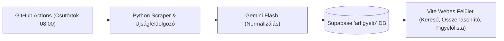

# Heti Árfigyelő (Lidl & Aldi)

Heti akciós újság és weboldal árak összehasonlítása, keresése és ártörténeti követése Supabase PostgreSQL adatbázissal és Google Gemini AI normalizálással.

## Rendszer felépítése



## Használat

### 1. Webes felület futtatása helyben
A felület a böngészőben érhető el (keresés, kártyás/táblázatos nézet, boltonkénti szűrés, figyelőlista és ártörténet modal):
```bash
cd web
npm install
npm run dev
```
Nyisd meg: `http://localhost:5173/`

### 2. Akciók frissítése (Scraper)
A virtuális környezet aktiválása után:
```bash
# Teljes akciós újságok párhuzamos feldolgozása (Lidl 76 oldal + Aldi 25 spread):
python scraper/extract_all_flyers.py

# Heti webes akciós oldalak letöltése:
python scraper/run.py

# Tetszőleges saját újság (PDF vagy fotó) beolvasása:
python scraper/flyer.py "fajl_vagy_url.pdf" --store lidl
```

### 3. Automatikus heti frissítés (GitHub Actions)
A `.github/workflows/scrape.yml` fájl minden csütörtökön automatikusan lefut, vagy a GitHub felületén gombnyomásra indítható (`Run workflow`).
A GitHub Repository Secrets-be az alábbi 3 változót kell felvenni:
- `GEMINI_API_KEY`
- `SUPABASE_URL`
- `SUPABASE_SERVICE_KEY`

### 4. Supabase Adatbázis sémája
- `stores`: boltok (Lidl, Aldi, Tesco, Kifli)
- `products`: normalizált terméknevek, kategóriák és alapegységek (`kg`, `l`, `db`)
- `offers`: akciós ajánlatok (ár, áthúzott ár, egységár, érvényességi dátumok, forrás: `web` / `flyer`)
